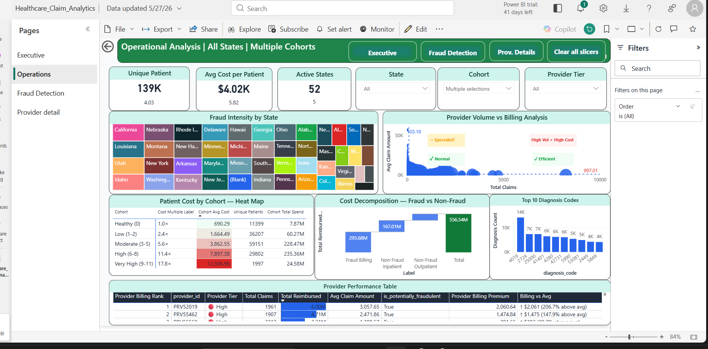
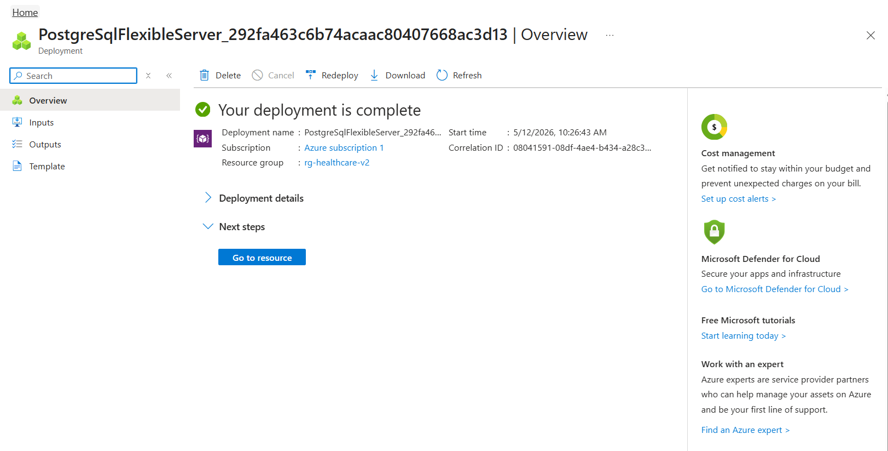
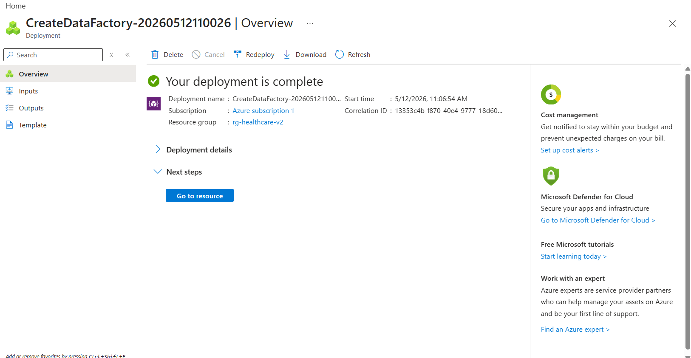
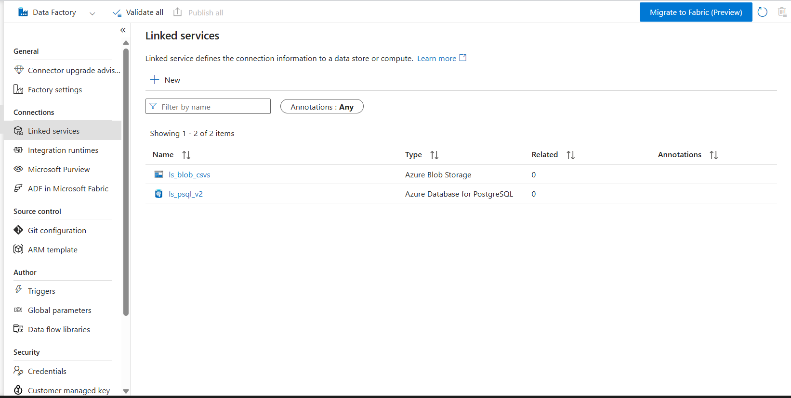
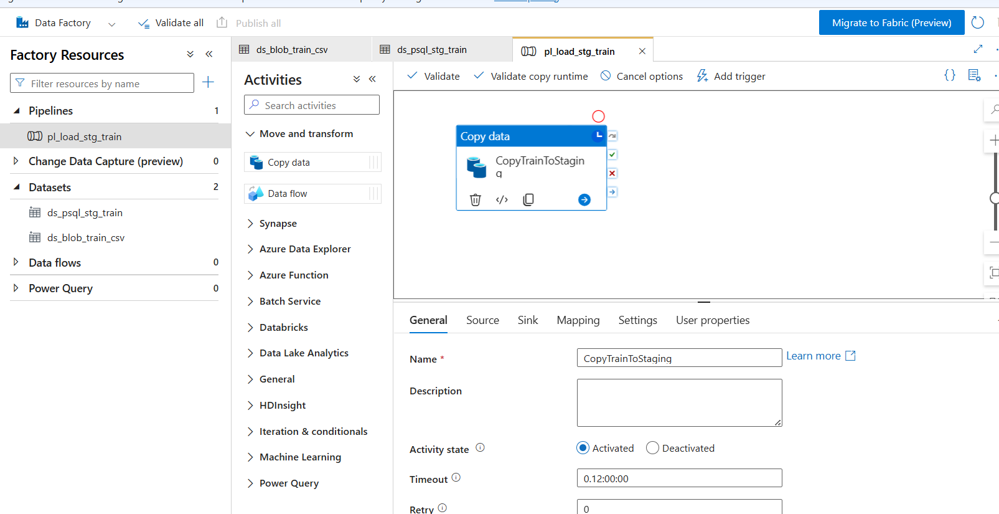
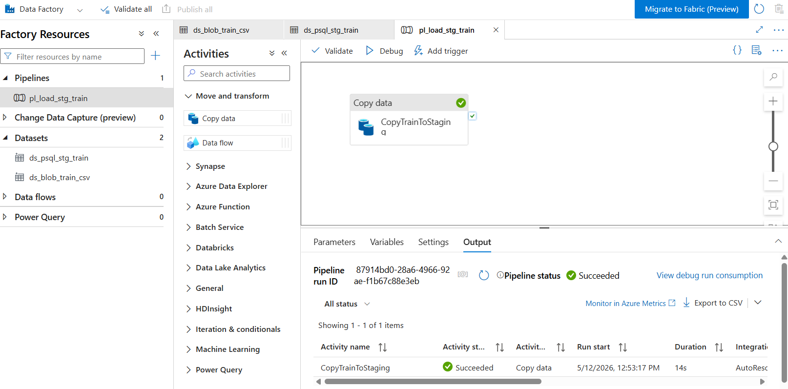
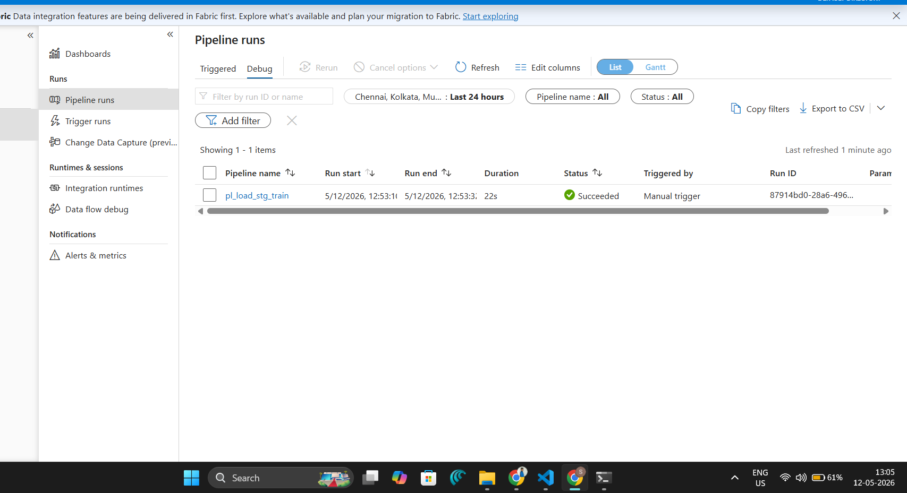

# 🏥 Healthcare Provider Fraud Detection V2

<div align="center">


### **End-to-end fraud detection analytics pipeline on real Medicare claims data**
### 558,211 Claims · 5,410 Providers · 226× Fraud Concentration · Top 50 Audit List Covers 35.3% of Flagged $

[📥 Download Dashboard](dashboard/Healthcare_Claim_Analytics.pbix) · [🗄️ SQL Schema](#️-database-schema) · [🤖 ML Model](#-ml-model) · [☁️ Azure Pipeline](#️-azure-adf-pipeline)

</div>

---

## 📌 Project Summary

This project builds a **production-grade fraud detection pipeline** on the [Kaggle Healthcare Provider Fraud Detection dataset](https://www.kaggle.com/datasets/rohitrox/healthcare-provider-fraud-detection-analysis), covering **558,211 Medicare claims** across **5,410 providers**, with claims dated Nov 2008 to Dec 2009.

> **Core Finding: Q4 billing providers (top 25% by total billing) are 226× more likely to be fraudulent than Q1 providers — 34.02% fraud rate vs 0.15%.**

The pipeline spans raw data ingestion → PostgreSQL star schema → Azure ADF orchestration → Python ML modeling → Power BI 4-page interactive dashboard with drill-through.

---

## 🔑 Key Findings

| Finding | Metric | Insight |
|---|---|---|
| **226× Billing Concentration** | Q1: 0.15% → Q4: 34.02% | Top billing quartile drives nearly all fraud |
| **Velocity Signal** | 96.08% precision | 96% of high-velocity providers (>10 claims/day) are fraud-flagged |
| **Diagnosis Stuffing** | 1.66× ratio | Fraud providers file 9.92% vs 5.99% claims with 9+ diagnosis codes |
| **Audit Target List** | 35.3% of flagged $ | Top 50 providers (0.9%) cover $104.31M, and all 50 are flagged |
| **ML Model Recall** | 90.1% | Logistic Regression catches 91 of 101 fraud providers on the held-out test set |
| **Cohort Cost Gradient** | 18.8× | Very High cohort costs $12,306 vs Healthy cohort $690 avg |
| **Flagged Exposure** | $295.68M | 506 flagged providers (9.35%) received 53.1% of the $556.54M reimbursed. This is gross exposure, not proven loss. [Reconciliation](docs/exposure_reconciliation.md) |

---

## 🏗️ Architecture

```
┌──────────────────────────────────────────────────────────────────────┐
│                         DATA PIPELINE                                │
│                                                                      │
│  Kaggle CSV → Azure Blob Storage → Azure ADF → PostgreSQL → Views   │
│  (558K rows)   (Raw landing zone)  (Pipeline)  (9 tables)  (ML feats)│
└──────────────────────────────────────────────────────────────────────┘
                                    ↓
┌──────────────────────────────────────────────────────────────────────┐
│                        ANALYTICS LAYER                               │
│                                                                      │
│   Python (scikit-learn)     →     Power BI (4 pages)                 │
│   LR + XGBoost + RF               Executive | Operations |           │
│   AUC 0.9573 | Recall 90.1%       Fraud Detection | Provider Detail  │
└──────────────────────────────────────────────────────────────────────┘
```

---

## 📊 Dashboard — 4 Pages

### [📥 Download Dashboard (.pbix)](dashboard/Healthcare_Claim_Analytics.pbix)

| Page | Purpose | Key Visuals |
|---|---|---|
| **Page 1 — Executive** | C-suite portfolio overview | 6 KPI cards, combo trend chart, decomposition tree, key influencers, gauge |
| **Page 2 — Operations** | State/cohort operational view | US fraud map, provider scatter, cohort heatmap, waterfall, top 10 diagnosis |
| **Page 3 — Fraud Detection** | 226× hero analysis + ML results | Quartile bar chart, ML cards, velocity scatter, diagnosis stuffing, investigation queue |
| **Page 4 — Provider Detail** | Single-provider drill-through | Billing trend, risk flags, vs portfolio comparison, investigation verdict |

### 📸 Dashboard Screenshots

> Screenshots predate the measure fix and show 440 providers and 8.13%. The `.pbix` now returns **506 and 9.35%**. See the [reconciliation](docs/exposure_reconciliation.md).

#### Page 1 — Executive Overview


#### Page 2 — Operations Analysis


#### Page 3 — Fraud Detection (226× Hero Finding)


#### Page 4 — Provider Detail (Drill-through)


---

## ☁️ Azure ADF Pipeline

Full cloud pipeline built on Azure — Blob Storage → Azure Data Factory → PostgreSQL (Aiven).


### Pipeline Screenshots

#### Resource Group Setup


#### PostgreSQL Initial Setup


#### Linked Services Configuration


#### ADF Pipeline Canvas


#### Pipeline Run — Success (5,410 rows)


#### ADF Monitor History


---

## 🗄️ Database Schema

**PostgreSQL — 9 tables, 2.43M total rows**

```
dim_beneficiary          (138,556 rows)  — Patient demographics + chronic conditions
dim_provider             (  5,410 rows)  — Provider fraud labels
dim_date                 (  1,096 rows)  — Date dimension
dim_diagnosis_code       (  2,213 rows)  — ICD-9 codes
fact_inpatient_claims    ( 40,474 rows)  — Inpatient claim records
fact_outpatient_claims   (517,737 rows)  — Outpatient claim records
bridge_claim_diagnosis   (1,710,000 rows)— Claim ↔ diagnosis mapping
v_provider_features      (  5,410 rows)  — ML feature view (28 engineered features)
v_patient_risk_score     (138,556 rows)  — Patient risk scoring view
```

**Key Engineered Features (`v_provider_features`):**

| Feature | Signal Type |
|---|---|
| `avg_daily_claims` | Velocity anomaly |
| `peak_daily_claims` | Outlier velocity |
| `claims_with_9plus_diagnoses` | Diagnosis stuffing |
| `avg_patient_chronic_count` | Patient complexity proxy |
| `coefficient_of_variation` | Billing inconsistency |
| `avg_patient_risk_score` | Composite patient risk |
| `distinct_attending_physicians` | Physician concentration |

---

## 🤖 ML Model

**Task**: Binary classification — predict `is_potentially_fraudulent` (provider level)

**Training**: 4,328 providers | **Test**: 1,082 providers | **Base fraud rate**: 9.35%

| Model | AUC | Recall (Fraud) | Precision (Fraud) | F1 |
|---|---|---|---|---|
| **Logistic Regression (balanced)** | **0.9573** | **90.1%** | **40.4%** | **0.558** |
| Random Forest | 0.9538 | 78.2% | 53.7% | 0.637 |
| XGBoost | 0.9404 | 65.3% | 56.9% | 0.608 |

All three use the default 0.5 threshold on the same 20% held-out split.

### Why XGBoost recall was 65%

**The low recall comes mostly from the 0.5 threshold, not from weak ranking.** XGBoost hits AUC 1.0 on train and 0.94 on test, so it memorises the training data and its scores for unseen fraud providers land far below 0.5. Of the 35 fraud providers it missed, the median score was only 0.09. XGBoost already uses `scale_pos_weight`, so class weighting is not the difference. The simpler Logistic Regression does not overfit this way, so 0.5 happens to suit it.

The threshold was tuned on 5-fold cross-validation inside the training set, then graded once on the test set:

| Model | Threshold | Queue | Fraud caught | Recall | Precision |
|---|---:|---:|---:|---:|---:|
| XGBoost, default | 0.50 | 116 | 66 / 101 | 65.3% | 56.9% |
| **XGBoost, tuned** | **0.022** | **313** | **94 / 101** | **93.1%** | **30.0%** |
| LR, default | 0.50 | 225 | 91 / 101 | 90.1% | 40.4% |
| LR, tuned | 0.402 | 264 | 92 / 101 | 91.1% | 34.8% |

**Fair comparison, same 225-provider queue:** LR catches 91 and XGBoost catches 84. LR is still the better screen here, but the real gap is 7 providers, not the 25 seen at the default threshold. The other 18 came from the threshold. Tuning buys recall with extra false positives, so the right threshold depends on how many cases the review team can handle.

**Investigation queue:** 225 is the test split only (1,082 providers). Scored out-of-fold across all 5,410 providers, LR flags **1,060** (434 true, 626 false positives) with **85.8% recall**, which is the more stable estimate of the 90.1%. Details: [`threshold_analysis.csv`](ml/reports/threshold_analysis.csv).

---

## 🎯 Audit Target List

**Business question: the audit team can open 50 files this cycle. Which 50, and how much of the flagged dollars do they cover?**

> **Top 50 providers (0.9% of 5,410) cover $104.31M, or 35.3% of the $295.68M at flagged providers. All 50 carry the fraud flag.**

| List size | % of providers | Flagged in list | Coverage of flagged $ |
|---:|---:|---:|---:|
| 10 | 0.2% | 10 | 11.4% |
| 25 | 0.5% | 25 | 21.9% |
| **50** | **0.9%** | **50** | **35.3%** |
| 100 | 1.8% | 93 | 52.2% |
| 200 | 3.7% | 170 | 71.5% |

**Ranking choice:** sorting by reimbursed dollars beat both model scores at list size 50.

| Ranking | Flagged in top 50 | Coverage of flagged $ |
|---|---:|---:|
| **Reimbursed dollars** | **50** | **35.3%** |
| LR score (out-of-fold) | 49 | 32.4% |
| XGBoost score (out-of-fold) | 50 | 31.8% |

For a list this short, a SQL sort is enough. The models earn their place further down, where billing stops separating cases: 7 of the top 100 by dollars are not flagged.

**Files:** [`audit_top50_providers.csv`](ml/reports/audit_top50_providers.csv) · [`audit_coverage_curve.csv`](ml/reports/audit_coverage_curve.csv) · [`04_audit_top50_providers.sql`](sql/analysis/04_fraud_detection/04_audit_top50_providers.sql)

**Read this with care:** "flagged dollars" means everything paid to labelled providers, not confirmed fraud loss. The label's origin is unknown and billing volume is its strongest predictor, so 50 of 50 may partly reflect how the label was built.

---

## 🛠️ Tech Stack

| Layer | Technology |
|---|---|
| **Data Ingestion** | Azure Data Factory (ADF) |
| **Cloud Storage** | Azure Blob Storage |
| **Database** | PostgreSQL 15 (Aiven cloud) |
| **Feature Engineering** | PostgreSQL views + window functions |
| **ML Pipeline** | Python — scikit-learn, pandas, numpy, matplotlib |
| **Visualization** | Microsoft Power BI Desktop |
| **Version Control** | Git + GitHub |

---

## 📁 Repository Structure

```
Healthcare-Insurance-Claims-Analytics/  (branch: v2-real-data)
│
├── azure/                              # Azure ADF pipeline screenshots
│   ├── 01_resource_group_initial.png
│   ├── 01_PostgresSQL_initial.png
│   ├── 02_linked_services.png
│   ├── 03_pipeline_canvas.png
│   ├── 04_pipeline_run_success.png
│   └── 05_adf_monitor_history.png
│
├── sql/                                # PostgreSQL schema + queries
│   ├── schema/                         # CREATE TABLE statements
│   ├── views/                          # v_provider_features, v_patient_risk_score
│
├── python/                             # ML pipeline notebooks
│   ├── 01_eda.ipynb
│   ├── 02_feature_engineering.ipynb
│   ├── 03_ml_models.ipynb              # LR vs XGBoost vs RF comparison
│   └── 04_shap_analysis.ipynb
│
├── dashboard/                          # Power BI files + screenshots
│   ├── Healthcare_Claim_Analytics.pbix # 4-page dashboard (Git LFS)
│   ├── Executive command center.png
│   ├── Fraud Dectection.png
│   ├── Operations.png
│   └── Provider Id Details.png
│
└── README.md
```

---

## 🚀 How to Run

### Prerequisites
```bash
pip install pandas numpy scikit-learn matplotlib seaborn psycopg2
```

### 1. Database Setup
```sql
-- Run in order:
-- sql/schema/01_create_tables.sql
-- sql/schema/02_create_views.sql
```

### 2. Load Data
```bash
psql -h <host> -U <user> -d healthcare_v2 -f sql/schema/01_create_tables.sql
```

### 3. Rebuild the Audit List and Threshold Analysis (no database needed)
```bash
pip install -r requirements.txt
python data/download_data.py
python ml/scripts/audit_targeting.py
```

### 4. Run ML Pipeline
```bash
jupyter notebook python/03_ml_models.ipynb
```

### 5. Open Dashboard
```
Open dashboard/Healthcare_Claim_Analytics.pbix in Power BI Desktop
```

---

## 💡 DAX Highlights

```dax
-- 226× Fraud Concentration Finding
Quartile Fraud Rate =
DIVIDE(
    CALCULATE(
        DISTINCTCOUNT('public v_provider_features'[provider_id]),
        'public v_provider_features'[label] = 1
    ),
    DISTINCTCOUNT('public v_provider_features'[provider_id]),
    0
)

-- Composite 6-Level Risk Flag
Risk Flag =
VAR IsQ4      = 'public v_provider_features'[Billing Quartile] = "Q4 (Highest)"
VAR IsVelocity = 'public v_provider_features'[peak_daily_claims] > 10
VAR IsFraud   = 'public v_provider_features'[label] = 1
RETURN
SWITCH(TRUE(),
    IsFraud && IsQ4 && IsVelocity, "CRITICAL",
    IsFraud && IsQ4,               "HIGH RISK",
    IsFraud && IsVelocity,         "FRAUD + VELOCITY",
    IsFraud,                       "FRAUD FLAGGED",
    IsQ4 && IsVelocity,            "MONITOR CLOSELY",
    IsQ4,                          "ELEVATED",
                                   "NORMAL")
```

---

## 📬 Contact

**Sumit Kumar Prajapat**

- 🔗 GitHub: [github.com/Skpkush](https://github.com/Skpkush)
- 💼 LinkedIn: [linkedin.com/in/sumit-kumar-prajapat](https://linkedin.com/in/sumit-kumar-prajapat)
- 🏅 Certifications: PL-300 · AZ-900 · DP-900 · AWS Cloud Practitioner

---

<div align="center">

**⭐ Star this repo if you found it useful!**

*Real Medicare data · End-to-end pipeline · Production-grade dashboard · 226× fraud finding*

</div>
